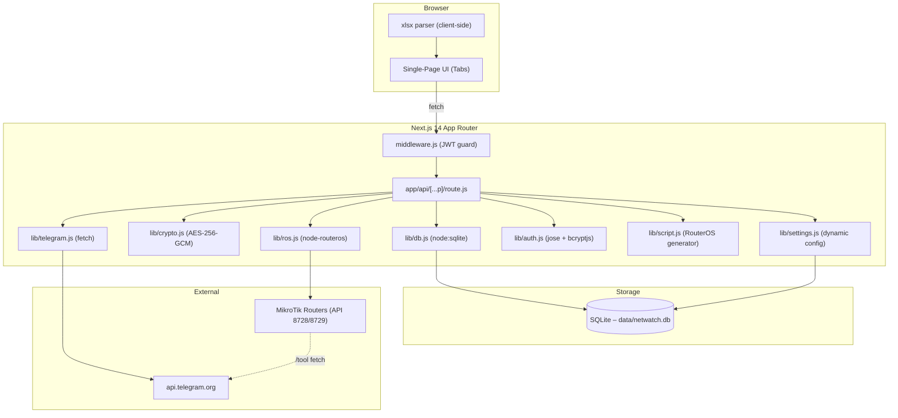
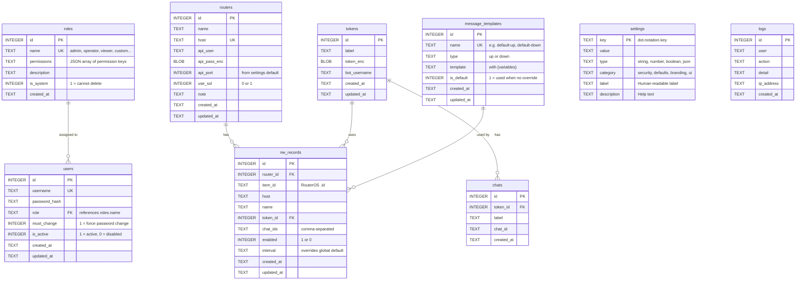
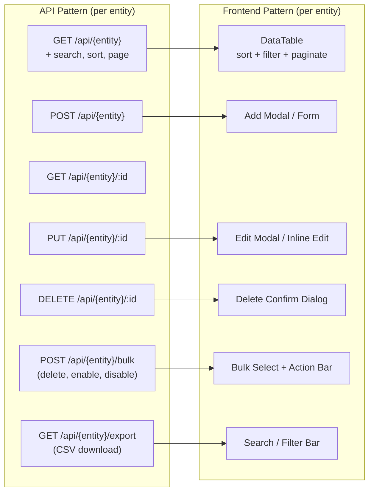
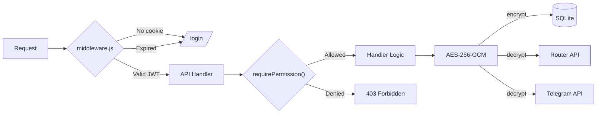
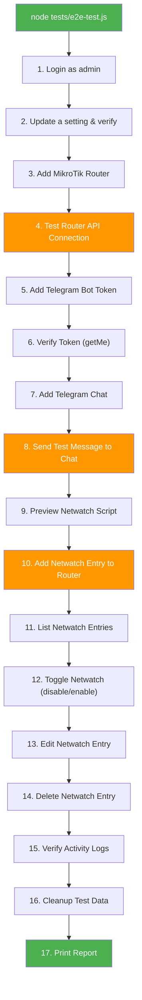
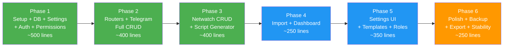

# 🛠️ Implementation Plan: MikroTik Netwatch + Telegram Alert Manager
## Commercial Edition — Fully Dynamic, Zero Hardcoding

## Goal Description

Build a **commercial-grade, fully dynamic web application** that manages MikroTik Netwatch entries across multiple routers and delivers Up/Down alerts via Telegram. **Every configurable value is stored in the database and editable from the frontend** — once deployed, the administrator never touches code or config files again.

> [!IMPORTANT]
> **Commercial requirement**: Every DB table has full CRUD from the frontend. All constants, templates, branding, and behavior are dynamic settings — not hardcoded.

---

## What "Fully Dynamic" Means

| Category | Hardcoded (old) | Dynamic (new) |
|----------|----------------|---------------|
| Lockout attempts & duration | `MAX_LOGIN_ATTEMPTS = 5` | Settings page → Security tab |
| JWT session expiry | `JWT_EXPIRY = '8h'` | Settings page → Security tab |
| Netwatch check interval | `'00:00:10'` | Per-entry or global default in Settings |
| Message template (up/down) | Emoji + HTML in `script.js` | Template editor with `{variables}` |
| App name & branding | `"Netwatch Manager"` in layout | Settings page → Branding tab |
| Default API port | `8728` | Settings page → Defaults tab |
| User roles & permissions | `ROLES = { ADMIN, OPERATOR, VIEWER }` | Roles table — add custom roles |
| Netwatch comment prefix | `'TG\|'` | Settings page → Defaults tab |
| Pagination page size | Magic number `25` | Settings page → UI tab |

---

## Architecture Overview



---

## Data Model (ER Diagram)



---

## Dynamic Settings System

All settings live in the `settings` table and are loaded at runtime. The frontend **Settings** page renders them by category with the correct input type.

### Seed Data (inserted on first run, editable forever after)

```js
const DEFAULT_SETTINGS = [
  // ── Security ──
  { key: 'security.max_login_attempts',  value: '5',         type: 'number',  category: 'security', label: 'Max Login Attempts',          description: 'Lock account after this many failures' },
  { key: 'security.lockout_minutes',     value: '5',         type: 'number',  category: 'security', label: 'Lockout Duration (minutes)',   description: 'How long a locked account stays locked' },
  { key: 'security.jwt_expiry_hours',    value: '8',         type: 'number',  category: 'security', label: 'Session Expiry (hours)',       description: 'Auto-logout after this many hours' },
  { key: 'security.password_min_length', value: '6',         type: 'number',  category: 'security', label: 'Minimum Password Length',      description: 'Enforce on password change' },

  // ── Defaults ──
  { key: 'defaults.api_port',            value: '8728',      type: 'number',  category: 'defaults', label: 'Default API Port',             description: 'Pre-filled when adding a router' },
  { key: 'defaults.api_ssl_port',        value: '8729',      type: 'number',  category: 'defaults', label: 'Default API-SSL Port',         description: 'Pre-filled when SSL is enabled' },
  { key: 'defaults.netwatch_interval',   value: '00:00:10',  type: 'string',  category: 'defaults', label: 'Default Netwatch Interval',    description: 'Check interval (hh:mm:ss)' },
  { key: 'defaults.netwatch_timeout',    value: '1000ms',    type: 'string',  category: 'defaults', label: 'Default Netwatch Timeout',     description: 'Ping timeout' },
  { key: 'defaults.comment_prefix',      value: 'TG|',       type: 'string',  category: 'defaults', label: 'Netwatch Comment Prefix',      description: 'Prefix for auto-generated comments' },

  // ── Branding ──
  { key: 'branding.app_name',            value: 'Netwatch Manager',  type: 'string',  category: 'branding', label: 'Application Name',    description: 'Shown in header, login, and browser tab' },
  { key: 'branding.app_logo_url',        value: '',                  type: 'string',  category: 'branding', label: 'Logo URL',             description: 'URL or path to logo image (leave empty for text)' },
  { key: 'branding.primary_color',       value: '#2563eb',           type: 'string',  category: 'branding', label: 'Primary Color',        description: 'Main accent color (hex)' },
  { key: 'branding.login_message',       value: '',                  type: 'string',  category: 'branding', label: 'Login Page Message',   description: 'Custom message on login screen' },

  // ── UI ──
  { key: 'ui.page_size',                 value: '25',        type: 'number',  category: 'ui',       label: 'Table Page Size',              description: 'Rows per page in all tables' },
  { key: 'ui.date_format',              value: 'YYYY-MM-DD', type: 'string',  category: 'ui',       label: 'Date Format',                  description: 'Display format for dates' },
  { key: 'ui.time_format',              value: 'HH:mm:ss',   type: 'string',  category: 'ui',       label: 'Time Format',                  description: 'Display format for times' },
  { key: 'ui.show_dashboard_stats',      value: 'true',      type: 'boolean', category: 'ui',       label: 'Show Dashboard Statistics',    description: 'Display stats cards on dashboard' },
];
```

### `lib/settings.js` — Dynamic Config Loader

```js
import { getDb } from './db';

// In-memory cache with TTL
let cache = null;
let cacheTime = 0;
const CACHE_TTL = 30_000; // 30 seconds

export function getSetting(key, fallback = '') {
  const all = getAllSettings();
  const row = all.find(s => s.key === key);
  if (!row) return fallback;

  switch (row.type) {
    case 'number':  return Number(row.value);
    case 'boolean': return row.value === 'true';
    case 'json':    try { return JSON.parse(row.value); } catch { return fallback; }
    default:        return row.value;
  }
}

export function getAllSettings() {
  if (cache && Date.now() - cacheTime < CACHE_TTL) return cache;
  const db = getDb();
  cache = db.prepare('SELECT * FROM settings ORDER BY category, key').all();
  cacheTime = Date.now();
  return cache;
}

export function getSettingsByCategory(category) {
  return getAllSettings().filter(s => s.category === category);
}

export function updateSetting(key, value) {
  const db = getDb();
  db.prepare('UPDATE settings SET value = ? WHERE key = ?').run(String(value), key);
  cache = null; // invalidate cache
}

export function invalidateCache() {
  cache = null;
}
```

> [!TIP]
> Every `lib/` module reads from `getSetting()` instead of a hardcoded constant. Example: `const maxAttempts = getSetting('security.max_login_attempts', 5);`

---

## Full CRUD for Every Table

Every entity gets the same 7-operation API surface and a matching frontend page with inline editing:



### Complete API Surface

| Entity | Endpoints | Frontend Page |
|--------|-----------|---------------|
| **Users** | `GET POST` `/api/users` · `GET PUT DELETE` `/api/users/:id` · `POST /api/users/:id/reset-password` · `POST /api/users/bulk` | `/dashboard/users` |
| **Roles** | `GET POST` `/api/roles` · `GET PUT DELETE` `/api/roles/:id` | `/dashboard/settings` (Roles tab) |
| **Routers** | `GET POST` `/api/routers` · `GET PUT DELETE` `/api/routers/:id` · `POST /api/routers/:id/test` · `POST /api/routers/bulk` · `GET /api/routers/export` | `/dashboard/routers` |
| **Tokens** | `GET POST` `/api/tokens` · `GET PUT DELETE` `/api/tokens/:id` · `POST /api/tokens/:id/verify` | `/dashboard/telegram` |
| **Chats** | `GET POST` `/api/tokens/:id/chats` · `PUT DELETE` `/api/chats/:id` · `POST /api/chats/:id/test` | `/dashboard/telegram` (nested) |
| **Netwatch** | `GET POST` `/api/netwatch/:routerId` · `PUT DELETE` `/api/netwatch/:routerId/:itemId` · `POST .../toggle` · `POST .../preview` · `POST /api/netwatch/:routerId/bulk` · `POST /api/netwatch/:routerId/sync` | `/dashboard/netwatch` |
| **Templates** | `GET POST` `/api/templates` · `GET PUT DELETE` `/api/templates/:id` · `POST /api/templates/:id/preview` | `/dashboard/settings` (Templates tab) |
| **Settings** | `GET` `/api/settings` · `GET` `/api/settings/:category` · `PUT` `/api/settings/:key` · `POST /api/settings/bulk-update` | `/dashboard/settings` |
| **Logs** | `GET` `/api/logs` (+ search, date range, pagination) · `DELETE /api/logs/clear` · `GET /api/logs/export` | `/dashboard/logs` |
| **Import** | `POST /api/import` · `POST /api/import/validate` | `/dashboard/import` |
| **Backup** | `GET /api/backup` (download) · `POST /api/backup/restore` (upload) | `/dashboard/settings` (Backup tab) |

---

## Project Structure

```
Netwatch/
├── plan.md                              # Original plan (preserved)
├── docs/
│   └── PROJECT_PLAN.md                  # This document
├── .env.example
├── .gitignore
├── jsconfig.json
├── next.config.mjs
├── package.json
│
├── app/
│   ├── layout.js                        # Root layout — reads branding from API
│   ├── page.js                          # Redirect → /login or /dashboard
│   ├── globals.css                      # CSS with CSS variables for dynamic colors
│   │
│   ├── login/
│   │   └── page.js                      # Login form — dynamic branding
│   │
│   ├── dashboard/
│   │   ├── layout.js                    # Sidebar + tabs, role-based menu
│   │   ├── page.js                      # Dashboard stats
│   │   ├── routers/page.js              # Router CRUD table
│   │   ├── telegram/page.js             # Tokens + Chats CRUD
│   │   ├── netwatch/page.js             # Netwatch entries CRUD
│   │   ├── import/page.js               # Excel/CSV import
│   │   ├── logs/page.js                 # Activity log (view + clear + export)
│   │   ├── users/page.js                # User management CRUD
│   │   └── settings/
│   │       └── page.js                  # Settings tabs: General, Security,
│   │                                    #   Branding, Templates, Roles, Backup
│   │
│   └── api/
│       └── [...p]/
│           ├── route.js                 # Catch-all dispatcher
│           └── handlers/
│               ├── auth.js              # login, logout, me, change-password
│               ├── users.js             # Full CRUD + reset-password + bulk
│               ├── roles.js             # Full CRUD
│               ├── routers.js           # Full CRUD + test + bulk + export
│               ├── tokens.js            # Full CRUD + verify
│               ├── chats.js             # Full CRUD + test
│               ├── netwatch.js          # Full CRUD + toggle + preview + sync + bulk
│               ├── templates.js         # Full CRUD + preview
│               ├── settings.js          # Read + update (single & bulk)
│               ├── import.js            # Import + validate
│               ├── logs.js              # List + clear + export
│               └── backup.js            # Download + restore
│
├── components/
│   ├── ui/
│   │   ├── Spinner.js                   # Loading spinner
│   │   ├── ErrorBanner.js               # Inline error display
│   │   ├── ConfirmDialog.js             # Delete confirmation modal
│   │   ├── ActionButton.js              # Button with loading state
│   │   ├── Modal.js                     # Reusable modal wrapper
│   │   ├── Badge.js                     # Status badge (online/offline/up/down)
│   │   ├── Toast.js                     # Success/error toast notifications
│   │   └── EmptyState.js               # "No data" placeholder
│   │
│   ├── data/
│   │   ├── DataTable.js                 # Dynamic table: sort, filter, paginate,
│   │   │                                #   bulk select, column toggle, export
│   │   ├── SearchBar.js                 # Search + filter controls
│   │   ├── Pagination.js               # Page nav with dynamic page size
│   │   └── BulkActionBar.js            # Floating bar for bulk operations
│   │
│   ├── forms/
│   │   ├── DynamicForm.js               # Renders form from field definitions
│   │   ├── FormField.js                 # Single field with validation
│   │   ├── RouterForm.js               # Router add/edit form
│   │   ├── TokenForm.js                # Token add/edit form
│   │   ├── ChatForm.js                 # Chat add/edit form
│   │   ├── NetwatchForm.js             # Netwatch add/edit form
│   │   ├── UserForm.js                 # User add/edit form
│   │   ├── RoleForm.js                 # Role add/edit with permission picker
│   │   └── TemplateForm.js             # Message template editor
│   │
│   ├── ScriptPreview.js                 # RouterOS script preview modal
│   ├── SettingsPanel.js                 # Dynamic settings renderer
│   ├── ImportWizard.js                  # Step-by-step import wizard
│   └── DashboardCards.js               # Stats cards component
│
├── lib/
│   ├── db.js                            # SQLite init + migrations + seed
│   ├── crypto.js                        # AES-256-GCM encrypt/decrypt
│   ├── auth.js                          # JWT + bcrypt + lockout
│   ├── ros.js                           # MikroTik API wrapper
│   ├── telegram.js                      # Telegram Bot API helpers
│   ├── script.js                        # RouterOS script generator (template-driven)
│   ├── settings.js                      # Dynamic settings loader + cache
│   ├── validate.js                      # Input validation
│   ├── permissions.js                   # Role-based permission checker
│   └── api-helpers.js                   # Shared: pagination, search, sort, CSV export
│
├── hooks/
│   ├── useFetch.js                      # Generic fetch wrapper with loading/error
│   ├── useSettings.js                   # Load and cache settings client-side
│   ├── useCRUD.js                       # Reusable CRUD hook for any entity
│   └── useDebounce.js                   # Debounce for search inputs
│
├── middleware.js                         # JWT guard
│
├── data/                                # SQLite DB (gitignored)
│   └── .gitkeep
│
├── tests/
│   ├── .env.test                        # Test credentials (gitignored)
│   └── e2e-test.js                      # Automated full-flow integration test
│
└── public/
    ├── favicon.ico
    └── sample-import.xlsx
```

---

## Proposed Changes — Phase by Phase

---

### Phase 1: Foundation — Setup, DB, Encryption, Dynamic Settings, Auth

#### [NEW] `package.json`
```json
{
  "name": "netwatch-manager",
  "version": "1.0.0",
  "private": true,
  "scripts": {
    "dev": "next dev",
    "build": "next build",
    "start": "next start"
  },
  "dependencies": {
    "next": "^14.2",
    "react": "^18.3",
    "react-dom": "^18.3",
    "jose": "^5.9",
    "bcryptjs": "^2.4",
    "node-routeros": "^1.7",
    "xlsx": "^0.18"
  }
}
```

#### [NEW] `.env.example`
```env
# Required: 64-character hex string (32 bytes) for AES-256-GCM
# Generate: node -e "console.log(require('crypto').randomBytes(32).toString('hex'))"
ENCRYPT_KEY=

# Optional: separate JWT secret (falls back to ENCRYPT_KEY)
JWT_SECRET=

# Server port
PORT=3000
```

> [!IMPORTANT]
> `.env` only has **infrastructure secrets** (encryption key, JWT secret). Every behavioral setting lives in the DB and is editable from the UI.

#### [NEW] `lib/db.js` — Full Schema with Settings + Roles + Templates

```js
import { DatabaseSync } from 'node:sqlite';
import { mkdirSync } from 'fs';
import { join } from 'path';
import { hashSync } from 'bcryptjs';

const DB_DIR = join(process.cwd(), 'data');
const DB_PATH = join(DB_DIR, 'netwatch.db');
let _db;

export function getDb() {
  if (_db) return _db;
  mkdirSync(DB_DIR, { recursive: true });
  _db = new DatabaseSync(DB_PATH);
  _db.exec('PRAGMA journal_mode = WAL');
  _db.exec('PRAGMA foreign_keys = ON');
  _db.exec('PRAGMA busy_timeout = 5000');
  migrate(_db);
  return _db;
}

function migrate(db) {
  // ── Schema version tracking ──
  db.exec(`
    CREATE TABLE IF NOT EXISTS schema_version (
      version INTEGER PRIMARY KEY
    );
  `);

  const ver = db.prepare(
    'SELECT MAX(version) as v FROM schema_version'
  ).get()?.v || 0;

  if (ver < 1) {
    db.exec(`
      -- Dynamic settings (replaces all hardcoded constants)
      CREATE TABLE IF NOT EXISTS settings (
        key   TEXT PRIMARY KEY,
        value TEXT NOT NULL DEFAULT '',
        type  TEXT NOT NULL DEFAULT 'string',
        category TEXT NOT NULL DEFAULT 'general',
        label TEXT NOT NULL DEFAULT '',
        description TEXT NOT NULL DEFAULT ''
      );

      -- Dynamic roles with JSON permissions
      CREATE TABLE IF NOT EXISTS roles (
        id          INTEGER PRIMARY KEY AUTOINCREMENT,
        name        TEXT UNIQUE NOT NULL,
        permissions TEXT NOT NULL DEFAULT '[]',
        description TEXT DEFAULT '',
        is_system   INTEGER NOT NULL DEFAULT 0,
        created_at  TEXT NOT NULL DEFAULT (datetime('now'))
      );

      CREATE TABLE IF NOT EXISTS users (
        id            INTEGER PRIMARY KEY AUTOINCREMENT,
        username      TEXT UNIQUE NOT NULL,
        password_hash TEXT NOT NULL,
        role          TEXT NOT NULL DEFAULT 'operator',
        must_change   INTEGER NOT NULL DEFAULT 0,
        is_active     INTEGER NOT NULL DEFAULT 1,
        created_at    TEXT NOT NULL DEFAULT (datetime('now')),
        updated_at    TEXT NOT NULL DEFAULT (datetime('now'))
      );

      CREATE TABLE IF NOT EXISTS routers (
        id           INTEGER PRIMARY KEY AUTOINCREMENT,
        name         TEXT NOT NULL,
        host         TEXT UNIQUE NOT NULL,
        api_user     TEXT NOT NULL DEFAULT 'admin',
        api_pass_enc BLOB,
        api_port     INTEGER NOT NULL DEFAULT 8728,
        use_ssl      INTEGER NOT NULL DEFAULT 0,
        note         TEXT DEFAULT '',
        created_at   TEXT NOT NULL DEFAULT (datetime('now')),
        updated_at   TEXT NOT NULL DEFAULT (datetime('now'))
      );

      CREATE TABLE IF NOT EXISTS tokens (
        id           INTEGER PRIMARY KEY AUTOINCREMENT,
        label        TEXT NOT NULL,
        token_enc    BLOB NOT NULL,
        bot_username TEXT DEFAULT '',
        created_at   TEXT NOT NULL DEFAULT (datetime('now')),
        updated_at   TEXT NOT NULL DEFAULT (datetime('now'))
      );

      CREATE TABLE IF NOT EXISTS chats (
        id         INTEGER PRIMARY KEY AUTOINCREMENT,
        token_id   INTEGER NOT NULL REFERENCES tokens(id) ON DELETE CASCADE,
        label      TEXT NOT NULL,
        chat_id    TEXT NOT NULL,
        created_at TEXT NOT NULL DEFAULT (datetime('now'))
      );

      CREATE TABLE IF NOT EXISTS message_templates (
        id         INTEGER PRIMARY KEY AUTOINCREMENT,
        name       TEXT UNIQUE NOT NULL,
        type       TEXT NOT NULL CHECK(type IN ('up','down')),
        template   TEXT NOT NULL,
        is_default INTEGER NOT NULL DEFAULT 0,
        created_at TEXT NOT NULL DEFAULT (datetime('now')),
        updated_at TEXT NOT NULL DEFAULT (datetime('now'))
      );

      CREATE TABLE IF NOT EXISTS nw_records (
        id          INTEGER PRIMARY KEY AUTOINCREMENT,
        router_id   INTEGER NOT NULL REFERENCES routers(id) ON DELETE CASCADE,
        item_id     TEXT,
        host        TEXT NOT NULL,
        name        TEXT NOT NULL,
        token_id    INTEGER REFERENCES tokens(id) ON DELETE SET NULL,
        chat_ids    TEXT DEFAULT '',
        enabled     INTEGER NOT NULL DEFAULT 1,
        interval    TEXT DEFAULT '',
        template_up_id   INTEGER REFERENCES message_templates(id) ON DELETE SET NULL,
        template_down_id INTEGER REFERENCES message_templates(id) ON DELETE SET NULL,
        created_at  TEXT NOT NULL DEFAULT (datetime('now')),
        updated_at  TEXT NOT NULL DEFAULT (datetime('now'))
      );

      CREATE TABLE IF NOT EXISTS logs (
        id         INTEGER PRIMARY KEY AUTOINCREMENT,
        user       TEXT NOT NULL,
        action     TEXT NOT NULL,
        detail     TEXT DEFAULT '',
        ip_address TEXT DEFAULT '',
        created_at TEXT NOT NULL DEFAULT (datetime('now'))
      );

      INSERT INTO schema_version VALUES (1);
    `);

    // ── Seed default roles ──
    const roles = [
      { name:'admin',    perms:'["*"]',                                           desc:'Full access',          sys:1 },
      { name:'operator', perms:'["routers.*","tokens.*","chats.*","netwatch.*","import.*","templates.read","logs.read"]', desc:'Manage routers and netwatch', sys:1 },
      { name:'viewer',   perms:'["routers.read","tokens.read","netwatch.read","logs.read","templates.read"]', desc:'Read-only access',     sys:1 },
    ];
    const insRole = db.prepare(
      'INSERT OR IGNORE INTO roles (name,permissions,description,is_system) VALUES (?,?,?,?)'
    );
    for (const r of roles) insRole.run(r.name, r.perms, r.desc, r.sys);

    // ── Seed default admin ──
    const cnt = db.prepare('SELECT COUNT(*) as c FROM users').get();
    if (cnt.c === 0) {
      db.prepare(
        'INSERT INTO users (username,password_hash,role,must_change) VALUES (?,?,?,?)'
      ).run('admin', hashSync('admin', 10), 'admin', 1);
    }

    // ── Seed default settings ──
    const insSetting = db.prepare(
      'INSERT OR IGNORE INTO settings (key,value,type,category,label,description) VALUES (?,?,?,?,?,?)'
    );
    for (const s of DEFAULT_SETTINGS) {
      insSetting.run(s.key, s.value, s.type, s.category, s.label, s.description);
    }

    // ── Seed default message templates ──
    const insTpl = db.prepare(
      'INSERT OR IGNORE INTO message_templates (name,type,template,is_default) VALUES (?,?,?,?)'
    );
    insTpl.run('Default UP', 'up',
      '✅ <b>{name}</b>\nHost: {host}\nRouter: {router}\nStatus: UP\nDate: {date}\nTime: {time}', 1);
    insTpl.run('Default DOWN', 'down',
      '🔴 <b>{name}</b>\nHost: {host}\nRouter: {router}\nStatus: DOWN\nDate: {date}\nTime: {time}', 1);
  }
}

const DEFAULT_SETTINGS = [
  // Security
  { key:'security.max_login_attempts',  value:'5',    type:'number',  category:'security', label:'Max Login Attempts',        description:'Lock account after this many failures' },
  { key:'security.lockout_minutes',     value:'5',    type:'number',  category:'security', label:'Lockout Duration (min)',     description:'How long a locked account stays locked' },
  { key:'security.jwt_expiry_hours',    value:'8',    type:'number',  category:'security', label:'Session Expiry (hours)',     description:'Auto-logout after this many hours' },
  { key:'security.password_min_length', value:'6',    type:'number',  category:'security', label:'Min Password Length',        description:'Enforced on password change' },
  // Defaults
  { key:'defaults.api_port',            value:'8728', type:'number',  category:'defaults', label:'Default API Port',           description:'Pre-filled when adding a router' },
  { key:'defaults.api_ssl_port',        value:'8729', type:'number',  category:'defaults', label:'Default SSL Port',           description:'Pre-filled when SSL is on' },
  { key:'defaults.netwatch_interval',   value:'00:00:10', type:'string', category:'defaults', label:'Netwatch Interval',       description:'Default check interval (hh:mm:ss)' },
  { key:'defaults.netwatch_timeout',    value:'1000ms',   type:'string', category:'defaults', label:'Netwatch Timeout',        description:'Default ping timeout' },
  { key:'defaults.comment_prefix',      value:'TG|',      type:'string', category:'defaults', label:'Comment Prefix',          description:'Prefix on auto-generated comments' },
  // Branding
  { key:'branding.app_name',           value:'Netwatch Manager', type:'string',  category:'branding', label:'Application Name',   description:'Header, login, and browser tab title' },
  { key:'branding.app_logo_url',       value:'',                 type:'string',  category:'branding', label:'Logo URL',            description:'Logo image URL (empty = text only)' },
  { key:'branding.primary_color',      value:'#2563eb',          type:'string',  category:'branding', label:'Primary Color',       description:'Main accent color (hex)' },
  { key:'branding.login_message',      value:'',                 type:'string',  category:'branding', label:'Login Page Message',  description:'Custom text shown on login screen' },
  { key:'branding.footer_text',        value:'',                 type:'string',  category:'branding', label:'Footer Text',         description:'Custom footer text' },
  // UI
  { key:'ui.page_size',               value:'25',        type:'number',  category:'ui', label:'Table Page Size',          description:'Default rows per page' },
  { key:'ui.date_format',             value:'YYYY-MM-DD', type:'string', category:'ui', label:'Date Format',              description:'Display format for dates' },
  { key:'ui.time_format',             value:'HH:mm:ss',   type:'string', category:'ui', label:'Time Format',              description:'Display format for times' },
  { key:'ui.show_dashboard_stats',    value:'true',        type:'boolean', category:'ui', label:'Show Dashboard Stats',   description:'Display statistics cards on dashboard' },
  { key:'ui.enable_export',           value:'true',        type:'boolean', category:'ui', label:'Enable CSV Export',       description:'Allow exporting tables to CSV' },
];
```

---

#### [NEW] `lib/permissions.js` — Dynamic Role-Based Access Control

```js
import { getDb } from './db';

/**
 * Permission keys follow: entity.action
 * e.g. routers.create, netwatch.delete, users.read, settings.update
 * Wildcard: routers.* = all router actions, * = everything
 */

export function hasPermission(userRole, requiredPermission) {
  const db = getDb();
  const role = db.prepare('SELECT permissions FROM roles WHERE name = ?').get(userRole);
  if (!role) return false;

  const perms = JSON.parse(role.permissions);

  // Wildcard = full access
  if (perms.includes('*')) return true;

  // Direct match
  if (perms.includes(requiredPermission)) return true;

  // Entity wildcard (e.g. "routers.*" matches "routers.delete")
  const [entity] = requiredPermission.split('.');
  if (perms.includes(`${entity}.*`)) return true;

  return false;
}

export function requirePermission(user, permission) {
  if (!hasPermission(user.role, permission)) {
    throw new Error(`Permission denied: ${permission}`);
  }
}

export function getPermissionsForRole(roleName) {
  const db = getDb();
  const role = db.prepare('SELECT permissions FROM roles WHERE name = ?').get(roleName);
  return role ? JSON.parse(role.permissions) : [];
}

/** All possible permission keys — used by the role editor UI */
export const ALL_PERMISSIONS = [
  'users.read','users.create','users.update','users.delete',
  'roles.read','roles.create','roles.update','roles.delete',
  'routers.read','routers.create','routers.update','routers.delete','routers.test',
  'tokens.read','tokens.create','tokens.update','tokens.delete',
  'chats.read','chats.create','chats.update','chats.delete','chats.test',
  'netwatch.read','netwatch.create','netwatch.update','netwatch.delete','netwatch.toggle','netwatch.sync',
  'templates.read','templates.create','templates.update','templates.delete',
  'import.execute',
  'logs.read','logs.clear','logs.export',
  'settings.read','settings.update',
  'backup.download','backup.restore',
];
```

---

#### [NEW] `lib/api-helpers.js` — Shared Pagination, Search, Sort, CSV Export

```js
import { getSetting } from './settings';
import { getDb } from './db';

/**
 * Build a paginated, searchable, sortable query for any table.
 * Used by every CRUD list endpoint.
 */
export function queryList(table, {
  search = '',
  searchFields = [],
  sort = 'id',
  order = 'DESC',
  page = 1,
  pageSize = null,
  where = '',
  whereParams = [],
}) {
  const db = getDb();
  const size = pageSize || getSetting('ui.page_size', 25);
  const offset = (page - 1) * size;

  // Whitelist sort direction
  const dir = order.toUpperCase() === 'ASC' ? 'ASC' : 'DESC';

  let conditions = where ? [where] : [];
  let params = [...whereParams];

  // Search across multiple fields with LIKE
  if (search && searchFields.length) {
    const clauses = searchFields.map(f => `${f} LIKE ?`);
    conditions.push(`(${clauses.join(' OR ')})`);
    for (const _ of searchFields) params.push(`%${search}%`);
  }

  const whereClause = conditions.length ? `WHERE ${conditions.join(' AND ')}` : '';

  const total = db.prepare(
    `SELECT COUNT(*) as count FROM ${table} ${whereClause}`
  ).get(...params).count;

  const rows = db.prepare(
    `SELECT * FROM ${table} ${whereClause} ORDER BY ${sort} ${dir} LIMIT ? OFFSET ?`
  ).all(...params, size, offset);

  return {
    data: rows,
    pagination: {
      page,
      pageSize: size,
      total,
      totalPages: Math.ceil(total / size),
    },
  };
}

/**
 * Export table to CSV string
 */
export function exportCsv(rows, columns) {
  if (!rows.length) return '';
  const header = columns.join(',');
  const body = rows.map(row =>
    columns.map(col => {
      const val = String(row[col] ?? '');
      return val.includes(',') || val.includes('"') || val.includes('\n')
        ? `"${val.replace(/"/g, '""')}"` : val;
    }).join(',')
  ).join('\n');
  return `${header}\n${body}`;
}

/**
 * Parse query params from request URL
 */
export function parseQuery(request) {
  const url = new URL(request.url);
  return {
    search:   url.searchParams.get('search') || '',
    sort:     url.searchParams.get('sort') || 'id',
    order:    url.searchParams.get('order') || 'DESC',
    page:     parseInt(url.searchParams.get('page') || '1'),
    pageSize: url.searchParams.get('pageSize') ? parseInt(url.searchParams.get('pageSize')) : null,
  };
}

/**
 * Add a log entry
 */
export function addLog(user, action, detail = '', ipAddress = '') {
  const db = getDb();
  db.prepare(
    'INSERT INTO logs (user, action, detail, ip_address) VALUES (?, ?, ?, ?)'
  ).run(user, action, detail, ipAddress);
}
```

---

#### [NEW] `lib/script.js` — Template-Driven Script Generator

```js
import { getDb } from './db';
import { getSetting } from './settings';

/**
 * Build RouterOS up/down scripts using message templates from the DB.
 * Falls back to the default template if no override is set.
 */
export function buildScripts({ name, host, token, chatIds, routerName,
                                templateUpId, templateDownId }) {
  const db = getDb();
  const prefix = getSetting('defaults.comment_prefix', 'TG|');

  // Load templates (use override or default)
  const upTpl = templateUpId
    ? db.prepare('SELECT template FROM message_templates WHERE id = ?').get(templateUpId)
    : db.prepare('SELECT template FROM message_templates WHERE type = ? AND is_default = 1').get('up');

  const downTpl = templateDownId
    ? db.prepare('SELECT template FROM message_templates WHERE id = ?').get(templateDownId)
    : db.prepare('SELECT template FROM message_templates WHERE type = ? AND is_default = 1').get('down');

  const upText   = (upTpl?.template   || '✅ {name} is UP').trim();
  const downText = (downTpl?.template || '🔴 {name} is DOWN').trim();

  function renderForRouterOS(template) {
    // Replace {variables} — date and time are RouterOS variables resolved at runtime
    return template
      .replace(/\{name\}/g,   name)
      .replace(/\{host\}/g,   host)
      .replace(/\{router\}/g, routerName || '')
      .replace(/\{date\}/g,   '$date')
      .replace(/\{time\}/g,   '$time')
      .replace(/\n/g,         '%0A');
  }

  const makeScript = (msg) => {
    const lines = [
      ':local date [/system clock get date]',
      ':local time [/system clock get time]',
    ];
    for (const chatId of chatIds) {
      lines.push(
        `/tool fetch url="https://api.telegram.org/bot${token}/sendMessage\\?chat_id=${chatId}&parse_mode=HTML&text=${msg}" keep-result=no`
      );
    }
    return lines.join('\r\n');
  };

  return {
    upScript:   makeScript(renderForRouterOS(upText)),
    downScript: makeScript(renderForRouterOS(downText)),
    comment:    `${prefix}${name}`,
  };
}
```

---

#### [NEW] `hooks/useCRUD.js` — Reusable Client-Side CRUD Hook

```js
'use client';
import { useState, useCallback } from 'react';

/**
 * Generic CRUD hook for any entity.
 * Usage: const { data, loading, error, list, create, update, remove } = useCRUD('/api/routers');
 */
export function useCRUD(baseUrl) {
  const [data, setData]       = useState(null);
  const [loading, setLoading] = useState(false);
  const [error, setError]     = useState(null);

  const request = useCallback(async (url, options = {}) => {
    setLoading(true);
    setError(null);
    try {
      const res = await fetch(url, {
        headers: { 'Content-Type': 'application/json' },
        ...options,
      });
      const json = await res.json();
      if (!res.ok) throw new Error(json.error || `Error ${res.status}`);
      return json;
    } catch (err) {
      setError(err.message || 'Network error — server unreachable');
      throw err;
    } finally {
      setLoading(false);
    }
  }, []);

  const list = useCallback(async (params = {}) => {
    const qs = new URLSearchParams(params).toString();
    const result = await request(`${baseUrl}${qs ? '?' + qs : ''}`);
    setData(result);
    return result;
  }, [baseUrl, request]);

  const create = useCallback(async (body) => {
    return request(baseUrl, { method: 'POST', body: JSON.stringify(body) });
  }, [baseUrl, request]);

  const update = useCallback(async (id, body) => {
    return request(`${baseUrl}/${id}`, { method: 'PUT', body: JSON.stringify(body) });
  }, [baseUrl, request]);

  const remove = useCallback(async (id) => {
    return request(`${baseUrl}/${id}`, { method: 'DELETE' });
  }, [baseUrl, request]);

  const bulk = useCallback(async (action, ids) => {
    return request(`${baseUrl}/bulk`, {
      method: 'POST',
      body: JSON.stringify({ action, ids }),
    });
  }, [baseUrl, request]);

  return { data, loading, error, list, create, update, remove, bulk, setError };
}
```

---

#### [NEW] `components/data/DataTable.js` — Universal Dynamic Table

Supports all entities — driven by a column definition array:

```js
// Usage example in any page:
const columns = [
  { key: 'id',    label: 'ID',    sortable: true },
  { key: 'name',  label: 'Name',  sortable: true,  searchable: true },
  { key: 'host',  label: 'Host',  sortable: true,  searchable: true },
  { key: 'note',  label: 'Note',  sortable: false },
  { key: '_actions', label: 'Actions', render: (row) => <ActionButtons row={row} /> },
];

<DataTable
  columns={columns}
  data={data}
  pagination={pagination}
  onSort={handleSort}
  onPageChange={handlePage}
  onSearch={handleSearch}
  bulkActions={[
    { label: 'Delete Selected', action: 'delete', variant: 'danger' },
    { label: 'Export CSV', action: 'export' },
  ]}
  onBulkAction={handleBulk}
/>
```

---

### Phase 2: Telegram Tokens + Chats (Full CRUD)

| Operation | Endpoint | Permission |
|-----------|----------|------------|
| List tokens | `GET /api/tokens` | `tokens.read` |
| Create token | `POST /api/tokens` (encrypts + validates via `getMe`) | `tokens.create` |
| Update token label | `PUT /api/tokens/:id` | `tokens.update` |
| Delete token | `DELETE /api/tokens/:id` (cascades chats) | `tokens.delete` |
| Re-verify token | `POST /api/tokens/:id/verify` | `tokens.read` |
| List chats | `GET /api/tokens/:id/chats` | `chats.read` |
| Add chat | `POST /api/tokens/:id/chats` | `chats.create` |
| Update chat | `PUT /api/chats/:id` | `chats.update` |
| Delete chat | `DELETE /api/chats/:id` | `chats.delete` |
| Test chat | `POST /api/chats/:id/test` | `chats.test` |

---

### Phase 3: Netwatch CRUD + Script Generation

| Operation | Endpoint | Permission |
|-----------|----------|------------|
| List entries | `GET /api/netwatch/:routerId` | `netwatch.read` |
| Add entry | `POST /api/netwatch/:routerId` | `netwatch.create` |
| Update entry | `PUT /api/netwatch/:routerId/:itemId` | `netwatch.update` |
| Delete entry | `DELETE /api/netwatch/:routerId/:itemId` | `netwatch.delete` |
| Toggle enable/disable | `POST .../toggle` | `netwatch.toggle` |
| Preview scripts | `POST .../preview` | `netwatch.read` |
| Sync with router | `POST /api/netwatch/:routerId/sync` | `netwatch.sync` |
| Bulk operations | `POST /api/netwatch/:routerId/bulk` | `netwatch.*` |

**Dynamic features:**
- Per-entry interval override (falls back to `defaults.netwatch_interval` setting)
- Per-entry template override (falls back to default templates)
- Router name included in scripts automatically
- Preview before push

---

### Phase 4: Excel/CSV Import

- Client-side parsing with `xlsx`
- Preview table with validation (IP check, duplicate check)
- Select router, token, chats, template overrides
- Per-row result report: `{ created, failed, results[] }`
- Respects dynamic settings for defaults

---

### Phase 5: Stability & UX

> [!WARNING]
> All fixes from the original plan are baked into the architecture above. The key patterns:

| Fix | Implementation |
|-----|---------------|
| Never fail silently | Every handler wrapped in try/catch, `friendly()` never returns empty |
| Inline errors | `ErrorBanner` component inside every form |
| Loading states | `ActionButton` with `Spinner` on every action |
| Table loading | Skeleton rows while fetching |
| Client validation | `validate.js` checks before fetch |
| Network errors | `useCRUD` hook catches fetch failures with readable message |
| Undefined in SQLite | `String(id ?? host)` — enforced in all handlers |
| Script preview | Preview button on add/edit form |

---

### Phase 6: Dashboard

Dynamic cards read from DB:
- Total routers (count)
- Total Netwatch entries (count, up/down from last sync)
- Recent logs (last 10)
- Quick-action buttons
- Toggleable via `ui.show_dashboard_stats` setting

---

### Phase 7: Message Template Editor (Full CRUD)

| Operation | Endpoint | Permission |
|-----------|----------|------------|
| List templates | `GET /api/templates` | `templates.read` |
| Create template | `POST /api/templates` | `templates.create` |
| Update template | `PUT /api/templates/:id` | `templates.update` |
| Delete template | `DELETE /api/templates/:id` | `templates.delete` |
| Preview render | `POST /api/templates/:id/preview` | `templates.read` |

**Template variables**: `{name}`, `{host}`, `{router}`, `{date}`, `{time}`, `{status}`, `{emoji}`

The editor shows a **live preview** as you type — renders the template with sample data.

---

### Phase 8: Roles, Backup/Restore, Users (Full CRUD)

**Users CRUD:**
- List, create, update, delete, toggle active/inactive, reset password
- Bulk operations: activate, deactivate, delete
- Admin can assign any role (dynamic from roles table)

**Roles CRUD:**
- List, create, update, delete (system roles cannot be deleted)
- Permission picker UI — checkboxes for each permission key from `ALL_PERMISSIONS`
- Custom roles (e.g. "NOC Operator" with only netwatch + routers access)

**Backup/Restore:**
- `GET /api/backup` → downloads SQLite file
- `POST /api/backup/restore` → uploads and replaces (admin only, with double confirmation)

---

### Phase 9 (Optional): Advanced Features

- **Up/down history table** — new `nw_history(id, nw_record_id, status, detected_at)` with full CRUD + chart
- **Bulk enable/disable across routers** — select entries from multiple routers
- **Flap protection** — configurable threshold in settings: `defaults.flap_count`, `defaults.flap_window_minutes`

---

## Security Implementation



| Threat | Mitigation |
|--------|------------|
| Password in DB | bcrypt cost 10 |
| Secrets at rest | AES-256-GCM, key in `.env` only |
| Session hijack | httpOnly, secure, sameSite cookie |
| Brute force | Dynamic lockout (settings-driven) |
| Default creds | `must_change` flag + banner |
| Unauthorized access | Dynamic RBAC — permission check on every endpoint |
| DB exposure | `data/` gitignored + backup/restore from UI |
| XSS in scripts | Server-generated, no user HTML |
| Data loss | One-click backup download from Settings |

---

## Frontend Page Inventory

| Page | Route | Key Components | CRUD For |
|------|-------|---------------|----------|
| Login | `/login` | Dynamic branding, error display | — |
| Dashboard | `/dashboard` | Stats cards, recent activity, quick actions | — |
| Routers | `/dashboard/routers` | DataTable, RouterForm, test button | `routers` |
| Telegram | `/dashboard/telegram` | Token DataTable, nested Chat DataTable, test buttons | `tokens`, `chats` |
| Netwatch | `/dashboard/netwatch` | Router selector, DataTable, NetwatchForm, ScriptPreview, toggle | `nw_records` |
| Import | `/dashboard/import` | ImportWizard (upload → preview → confirm → report) | `nw_records` (bulk create) |
| Users | `/dashboard/users` | DataTable, UserForm, reset password, toggle active | `users` |
| Logs | `/dashboard/logs` | DataTable with date range filter, clear button, export | `logs` |
| Settings | `/dashboard/settings` | Tabbed: General, Security, Branding, Templates, Roles, Backup | `settings`, `message_templates`, `roles` |

---

## Verification Plan

### Automated E2E Test — Full Integration

> [!IMPORTANT]
> After the project is complete, run `node tests/e2e-test.js` to automatically test the **entire flow** — login, router API, Telegram messaging, and Netwatch creation — using real credentials against your live infrastructure.

#### Test Architecture



> Orange = hits external services (MikroTik router / Telegram API)

---

#### [NEW] `tests/.env.test` — Test Credentials (gitignored)

```env
# ============================================
# E2E TEST CREDENTIALS
# This file is gitignored — never commit it
# ============================================

# App
TEST_BASE_URL=http://localhost:3000
TEST_ADMIN_USER=admin
TEST_ADMIN_PASS=admin

# Telegram Bot
TEST_BOT_TOKEN=8496998568:AAERaCYHjajvvlvo9Hq7fPXAfwvTR5orN5s
TEST_CHAT_ID=-5443904638

# MikroTik Router
TEST_ROUTER_HOST=118.179.157.122
TEST_ROUTER_USER=jahid
TEST_ROUTER_PASS=J@#1d
TEST_ROUTER_PORT=1142
```

> [!CAUTION]
> `tests/.env.test` contains real credentials and is **always gitignored**. Never commit it. The `.gitignore` file includes `tests/.env.test`.

---

#### [NEW] `tests/e2e-test.js` — Automated Full-Flow Test

```js
/**
 * Netwatch Manager — Automated E2E Integration Test
 *
 * Tests the entire application flow with real credentials:
 *   Login → Router → Telegram → Netwatch → Logs → Cleanup
 *
 * Usage:
 *   1. Start the app:  npm start
 *   2. Run the test:   node tests/e2e-test.js
 */

import { readFileSync } from 'fs';
import { join, dirname } from 'path';
import { fileURLToPath } from 'url';

const __dirname = dirname(fileURLToPath(import.meta.url));

// ── Load test config ──
function loadEnv(path) {
  const lines = readFileSync(path, 'utf8').split('\n');
  const env = {};
  for (const line of lines) {
    const trimmed = line.trim();
    if (!trimmed || trimmed.startsWith('#')) continue;
    const [key, ...rest] = trimmed.split('=');
    env[key.trim()] = rest.join('=').trim();
  }
  return env;
}

const cfg = loadEnv(join(__dirname, '.env.test'));
const BASE = cfg.TEST_BASE_URL || 'http://localhost:3000';

// ── State ──
let cookie = '';
let routerId = null;
let tokenId = null;
let chatId = null;
let netwatchItemId = null;
const results = [];

// ── Helpers ──
async function api(method, path, body = null) {
  const opts = {
    method,
    headers: { 'Content-Type': 'application/json' },
  };
  if (cookie) opts.headers['Cookie'] = cookie;
  if (body) opts.body = JSON.stringify(body);

  const res = await fetch(`${BASE}/api/${path}`, opts);

  // Capture session cookie
  const setCookie = res.headers.get('set-cookie');
  if (setCookie) {
    const match = setCookie.match(/nw_token=([^;]+)/);
    if (match) cookie = `nw_token=${match[1]}`;
  }

  const json = await res.json();
  return { status: res.status, ok: res.ok, ...json };
}

function test(name, fn) {
  return async () => {
    try {
      await fn();
      results.push({ name, status: '✅ PASS' });
      console.log(`  ✅ ${name}`);
    } catch (err) {
      results.push({ name, status: '❌ FAIL', error: err.message });
      console.log(`  ❌ ${name}: ${err.message}`);
    }
  };
}

function assert(condition, msg) {
  if (!condition) throw new Error(msg);
}

// ── Test Steps ──
const tests = [

  test('1. Login as admin', async () => {
    const r = await api('POST', 'login', {
      username: cfg.TEST_ADMIN_USER,
      password: cfg.TEST_ADMIN_PASS,
    });
    assert(r.ok !== false && cookie, `Login failed: ${r.error || 'no cookie'}`);
  }),

  test('2. Get current user (me)', async () => {
    const r = await api('GET', 'me');
    assert(r.username === cfg.TEST_ADMIN_USER, `Expected ${cfg.TEST_ADMIN_USER}, got ${r.username}`);
  }),

  test('3. Update a setting & verify', async () => {
    await api('PUT', 'settings/branding.app_name', { value: 'E2E Test App' });
    const r = await api('GET', 'settings/branding');
    const appName = r.data?.find(s => s.key === 'branding.app_name');
    assert(appName?.value === 'E2E Test App', 'Setting not updated');
    // Reset
    await api('PUT', 'settings/branding.app_name', { value: 'Netwatch Manager' });
  }),

  test('4. Add MikroTik Router', async () => {
    const r = await api('POST', 'routers', {
      name: 'E2E-Test-Router',
      host: cfg.TEST_ROUTER_HOST,
      api_user: cfg.TEST_ROUTER_USER,
      api_pass: cfg.TEST_ROUTER_PASS,
      api_port: parseInt(cfg.TEST_ROUTER_PORT),
      use_ssl: 0,
      note: 'Added by E2E test',
    });
    assert(r.id || r.data?.id, `Router add failed: ${r.error || 'no id'}`);
    routerId = r.id || r.data?.id;
  }),

  test('5. Test Router API Connection', async () => {
    const r = await api('POST', `routers/${routerId}/test`);
    assert(r.name || r.version, `API test failed: ${r.error || 'no identity'}`);
    console.log(`     → Router: ${r.name}, v${r.version}, up ${r.uptime}`);
  }),

  test('6. Add Telegram Bot Token', async () => {
    const r = await api('POST', 'tokens', {
      label: 'E2E-Test-Bot',
      token: cfg.TEST_BOT_TOKEN,
    });
    assert(r.id || r.data?.id, `Token add failed: ${r.error || 'no id'}`);
    tokenId = r.id || r.data?.id;
    if (r.bot_username) console.log(`     → Bot: @${r.bot_username}`);
  }),

  test('7. Verify Token (getMe)', async () => {
    const r = await api('POST', `tokens/${tokenId}/verify`);
    assert(r.username || r.bot_username, `Verify failed: ${r.error}`);
  }),

  test('8. Add Telegram Chat', async () => {
    const r = await api('POST', `tokens/${tokenId}/chats`, {
      label: 'E2E-Test-Chat',
      chat_id: cfg.TEST_CHAT_ID,
    });
    assert(r.id || r.data?.id, `Chat add failed: ${r.error || 'no id'}`);
    chatId = r.id || r.data?.id;
  }),

  test('9. Send Test Message to Chat', async () => {
    const r = await api('POST', `chats/${chatId}/test`);
    assert(!r.error, `Send test failed: ${r.error}`);
    console.log('     → Check Telegram — test message should have arrived');
  }),

  test('10. Preview Netwatch Script', async () => {
    const r = await api('POST', `netwatch/${routerId}/preview`, {
      host: '8.8.8.8',
      name: 'Google DNS (E2E Test)',
      token_id: tokenId,
      chat_ids: cfg.TEST_CHAT_ID,
    });
    assert(r.upScript || r.up_script, `Preview failed: ${r.error}`);
    console.log('     → Script preview generated OK');
  }),

  test('11. Add Netwatch Entry to Router', async () => {
    const r = await api('POST', `netwatch/${routerId}`, {
      host: '8.8.8.8',
      name: 'Google DNS (E2E Test)',
      token_id: tokenId,
      chat_ids: cfg.TEST_CHAT_ID,
    });
    assert(r.item_id || r.data?.item_id || r.id, `Netwatch add failed: ${r.error}`);
    netwatchItemId = r.item_id || r.data?.item_id || r.id;
    console.log(`     → Netwatch item: ${netwatchItemId}`);
  }),

  test('12. List Netwatch Entries', async () => {
    const r = await api('GET', `netwatch/${routerId}`);
    const entries = r.data || r;
    assert(Array.isArray(entries) || entries.data, 'Expected array of entries');
  }),

  test('13. Toggle Netwatch (disable)', async () => {
    const r = await api('POST', `netwatch/${routerId}/${netwatchItemId}/toggle`);
    assert(!r.error, `Toggle failed: ${r.error}`);
  }),

  test('14. Toggle Netwatch (re-enable)', async () => {
    const r = await api('POST', `netwatch/${routerId}/${netwatchItemId}/toggle`);
    assert(!r.error, `Toggle failed: ${r.error}`);
  }),

  test('15. Edit Netwatch Entry', async () => {
    const r = await api('PUT', `netwatch/${routerId}/${netwatchItemId}`, {
      host: '8.8.8.8',
      name: 'Google DNS (E2E EDITED)',
      token_id: tokenId,
      chat_ids: cfg.TEST_CHAT_ID,
    });
    assert(!r.error, `Edit failed: ${r.error}`);
  }),

  test('16. Delete Netwatch Entry from Router', async () => {
    const r = await api('DELETE', `netwatch/${routerId}/${netwatchItemId}`);
    assert(!r.error, `Delete failed: ${r.error}`);
  }),

  test('17. Verify Activity Logs', async () => {
    const r = await api('GET', 'logs?search=E2E');
    const logs = r.data || [];
    assert(logs.length > 0, 'No E2E activity in logs');
    console.log(`     → Found ${logs.length} E2E log entries`);
  }),
];

// ── Cleanup & Run ──
async function cleanup() {
  console.log('\n🧹 Cleaning up test data...');
  if (chatId) await api('DELETE', `chats/${chatId}`).catch(() => {});
  if (tokenId) await api('DELETE', `tokens/${tokenId}`).catch(() => {});
  if (routerId) await api('DELETE', `routers/${routerId}`).catch(() => {});
  console.log('   Done.\n');
}

async function run() {
  console.log('╔══════════════════════════════════════════════╗');
  console.log('║   Netwatch Manager — E2E Integration Test   ║');
  console.log('╠══════════════════════════════════════════════╣');
  console.log(`║ Target:   ${BASE.padEnd(34)}║`);
  console.log(`║ Router:   ${cfg.TEST_ROUTER_HOST.padEnd(34)}║`);
  console.log(`║ Bot:      ...${cfg.TEST_BOT_TOKEN.slice(-8).padEnd(31)}║`);
  console.log('╚══════════════════════════════════════════════╝\n');

  for (const t of tests) await t();

  await cleanup();

  // ── Report ──
  const passed = results.filter(r => r.status.includes('PASS')).length;
  const failed = results.filter(r => r.status.includes('FAIL')).length;

  console.log('═══════════════ TEST REPORT ═══════════════');
  for (const r of results) {
    console.log(`  ${r.status}  ${r.name}${r.error ? ` (${r.error})` : ''}`);
  }
  console.log('═══════════════════════════════════════════');
  console.log(`  Total: ${results.length} | Passed: ${passed} | Failed: ${failed}`);
  console.log('═══════════════════════════════════════════\n');

  process.exit(failed > 0 ? 1 : 0);
}

run().catch(err => {
  console.error('Fatal error:', err);
  process.exit(1);
});
```

---

#### Updated `.gitignore` (adds test credentials)

```
node_modules/
.next/
data/*.db
data/*.db-wal
data/*.db-shm
.env
tests/.env.test
```

---

#### How to Run the E2E Test

```bash
# 1. Make sure the app is running
npm run build && npm start

# 2. In another terminal, run the test
node tests/e2e-test.js
```

**Expected output:**
```
╔══════════════════════════════════════════════╗
║   Netwatch Manager — E2E Integration Test   ║
╠══════════════════════════════════════════════╣
║ Target:   http://localhost:3000              ║
║ Router:   118.179.157.122                   ║
║ Bot:      ...rN5s                            ║
╚══════════════════════════════════════════════╝

  ✅ 1. Login as admin
  ✅ 2. Get current user (me)
  ✅ 3. Update a setting & verify
  ✅ 4. Add MikroTik Router
  ✅ 5. Test Router API Connection
     → Router: MyRouter, v7.14, up 5d12:30:00
  ✅ 6. Add Telegram Bot Token
     → Bot: @my_netwatch_bot
  ✅ 7. Verify Token (getMe)
  ✅ 8. Add Telegram Chat
  ✅ 9. Send Test Message to Chat
     → Check Telegram — test message should have arrived
  ✅ 10. Preview Netwatch Script
     → Script preview generated OK
  ✅ 11. Add Netwatch Entry to Router
     → Netwatch item: *3A
  ✅ 12. List Netwatch Entries
  ✅ 13. Toggle Netwatch (disable)
  ✅ 14. Toggle Netwatch (re-enable)
  ✅ 15. Edit Netwatch Entry
  ✅ 16. Delete Netwatch Entry from Router
  ✅ 17. Verify Activity Logs
     → Found 8 E2E log entries

🧹 Cleaning up test data...
   Done.

═══════════════ TEST REPORT ═══════════════
  ✅ PASS  1. Login as admin
  ✅ PASS  2. Get current user (me)
  ...
═══════════════════════════════════════════
  Total: 17 | Passed: 17 | Failed: 0
═══════════════════════════════════════════
```

---

### Manual Verification
| # | Test | Expected |
|---|------|----------|
| 1 | Change `branding.app_name` in Settings → reload | Header and tab title update |
| 2 | Change `security.max_login_attempts` to 3 → fail login 3 times | Account locks |
| 3 | Create custom role "noc" with only `netwatch.*` + `routers.read` | NOC user can see routers but not edit, can manage netwatch |
| 4 | Create a message template with `{name} at {host} on {router}` → preview | Renders correctly |
| 5 | Add router → Test API | Identity, version, uptime shown |
| 6 | Add token → Add 2 chats → test each | Messages received |
| 7 | Add Netwatch with custom template → preview script | Script uses custom template |
| 8 | Import Excel (5 rows, 1 bad IP, 1 dup) | 3 OK, 2 failed with reasons |
| 9 | Backup → download → restore | DB restored successfully |
| 10 | Every table: search, sort, paginate, bulk delete, CSV export | All work |
| 11 | Viewer role user tries to delete a router | 403 error shown |
| 12 | Change `ui.page_size` to 10 → reload table | Shows 10 rows per page |

---

## Implementation Order



**Total estimated**: ~2,150 lines across ~40 files.

> Green = Core · Blue = Feature · Orange = Polish
